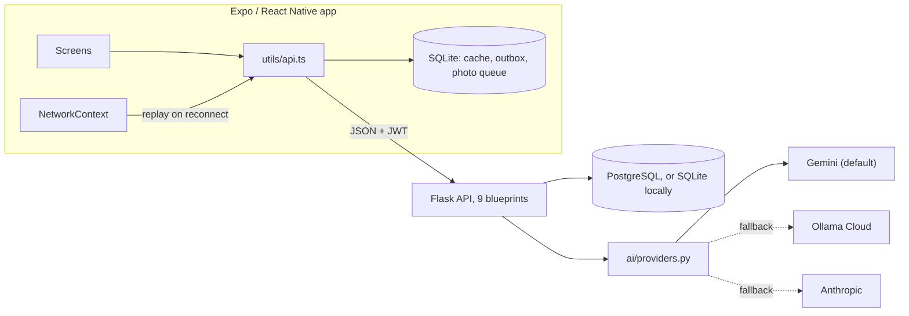

<p align="center">
  
</p>

# Field Force Contractor

A mobile app and Flask API for oil-services field contractors: work assigned tickets, prove you are on site before starting, run safety and vehicle checks, capture job photos, log drive time and get AI-drafted inspection reports, with offline support for the parts of the job that happen without signal.

Team capstone from the Coding Temple Tech Residency (March to May 2026), built by an eight-person team. This repository is my public fork of the team's code, forked from [TroyWenzel/TR42-Contractor](https://github.com/TroyWenzel/TR42-Contractor). Pull request numbers in the commit history refer to the team's repository, not this fork. My own work is listed under [My contributions](#my-contributions).

This is a demo-stage project: there is no app-store release and no public deployment linked here. See [Status and known limitations](#status-and-known-limitations).

## Features

- **Tickets and map.** Assigned tickets as a list or on a map (`react-native-maps`) with status-colored pins and a Navigate button that opens the site in Google Maps.
- **On-site checks before work starts.** Start Task requires Face ID or fingerprint (`expo-local-authentication`) or a PIN, a GPS check that the contractor is within 100 feet of the site, and a six-item PPE checklist. The API will not move a ticket to `IN_PROGRESS` without a start time, start coordinates and the PPE attestation.
- **Completion records.** Complete Task captures a signature plus the end time and location, then sends the ticket for supervisor approval. The API flags simple anomalies, such as an end time earlier than the start time.
- **Truck pre-trip inspection.** A checklist built from inspection templates served by the API (the demo seed has 6 sections and 33 items). Submissions are queued on the device when offline.
- **Drive-time tracker.** Driving, on-duty, off-duty and sleeper-berth status changes, with a dashboard bar that turns yellow one hour before the 11-hour daily driving limit and red at 30 minutes.
- **Job-site photos.** Camera or library photos attached to a ticket, validated and stripped of EXIF metadata on the server, and queued on the device when offline.
- **AI assistance:**
  - turn field notes into a structured inspection report, streamed to the screen as it is generated, then refine it with feedback;
  - analyze a job-site photo for safety concerns; a HIGH-severity result flags the ticket for review;
  - a chat assistant prompted for oil-services field work, safety and OSHA questions;
  - an incident-report flow that pairs the AI photo analysis with OSHA citation suggestions from a built-in keyword list;
  - saved reports and chats, exportable as branded PDFs (`expo-print`, `expo-sharing`).
- **Account and profile.** JWT login (tokens last 14 hours), offline login with a PIN, profile, license details with an expiration banner, task history and dashboard stats from the analytics endpoints.
- **Contacts.** Contacts come from the API. The one-to-one messaging screen is a UI prototype backed by in-memory demo messages.

## My contributions

I was on the team as a full-stack developer with a backend focus. Over the residency I made 173 of the 448 commits (47 of them merges), the most of any contributor, and merged 22 pull requests into the team's main branch, also the most of anyone. Jonathan Hubbard made the most non-merge commits. App paths below are relative to `frontend/field-force-contractor/`.

- **AI layer, backend and app.** Provider abstraction with retry and fallback, structured inspection reports, SSE streaming, refine, photo analysis with ticket flagging, chat, and saved reports and chats: `backend/app/blueprints/ai/` (`providers.py`, `routes.py`, `errors.py`, `schemas.py`) and `backend/smoke_test_ai.py`. In the app: `utils/aiClient.ts`, `screens/ChatAssistantScreen.tsx`, `screens/InspectionAssistScreen.tsx`, `screens/PhotoReviewScreen.tsx`, `screens/IncidentReportScreen.tsx`, `screens/SavedReportsScreen.tsx`, `utils/pdfExport.ts` and `components/MarkdownView.tsx`.
- **Offline data layer.** `utils/db.ts`, `utils/cache.ts`, `utils/outbox.ts`, `utils/photoOutbox.ts`, the offline-aware helpers in `utils/api.ts`, `contexts/NetworkContext.tsx` and `components/OfflineBanner.tsx`.
- **Photo pipeline.** `backend/app/blueprints/photos/routes.py`, `backend/app/util/photo_validation.py` and `backend/smoke_test_photos.py`.
- **Ticket workflow.** I extended `screens/TicketDetailScreen.tsx`, which charlie7estrada built (verification modal, GPS capture, camera, proximity check). My additions: loading real ticket data from the API, real Face ID and fingerprint checks, the 100-foot threshold, photo upload with per-photo analysis, the PPE gate (`components/PPEChecklistModal.tsx`, `constants/ppe.ts` and the server-side check in `backend/app/blueprints/tickets/routes.py`), signature capture (`components/SignatureModal.tsx`) and showcase mode (`constants/showcase.ts`, `DEMO_REVERT.md`). I also built `screens/MapScreen.tsx` and connected the Tickets, License, Task History and Profile screens to the API.
- **Drive time and inspections.** `backend/app/blueprints/drive_time/routes.py`, `screens/DriveTimeTrackerScreen.tsx`, `components/DriveTimeStatusBar.tsx`, `backend/app/blueprints/inspections/routes.py`, `backend/seed_inspections.py` and `screens/InspectionScreen.tsx`.
- **Schema sync.** I rewrote `backend/app/models.py` as SQLAlchemy 2.0 typed models that mirror the team's shared Postgres schema, building on ncespedes1's original models and JamesBustamante44's ERD, and reworked `backend/app/blueprints/analytics/routes.py` (first built by JamesBustamante44) to match it.
- **Auth, deployment and tooling.** Login wiring (`contexts/AuthContext.tsx`, `utils/secureStorage.ts`); moving `SECRET_KEY` into the environment, adding CORS and consistent auth errors, with the first pytest fixtures and auth tests (`backend/tests/conftest.py`, `backend/tests/test_auth.py`, later extended by ncespedes1); the gunicorn `Procfile`, `DATABASE_URL` handling and photo-upload limits in `backend/config.py` (a file ncespedes1 created), the database guardrails in `backend/flask_app.py`, `backend/seed_dev.py` and `backend/DATABASE_SAFETY.md`; the EAS `preview` profile that builds an APK; and cold-start handling (a 65-second request timeout and a wake-up ping) in `utils/api.ts`.

## Tech stack

| Layer | Tools |
| --- | --- |
| Mobile app | Expo SDK 54, React Native 0.81, React 19, TypeScript, React Navigation (native stack), expo-sqlite, expo-secure-store, expo-local-authentication, expo-location, expo-image-picker, react-native-maps |
| API | Python, Flask 3.1, Flask-SQLAlchemy with SQLAlchemy 2.0, marshmallow, python-jose (JWT), Werkzeug password hashing, Pillow, gunicorn |
| Data | PostgreSQL (the team's shared database); SQLite for local development and tests |
| AI | Google Gemini (`google-genai`), Anthropic (`anthropic`), Ollama Cloud through the `openai` SDK |
| Email | Resend (password-reset endpoint) |
| Tests | pytest, pytest-flask |

## Architecture



- `frontend/field-force-contractor/` is the Expo app. `utils/api.ts` is its HTTP client: it holds the API base URL, attaches the JWT stored with `expo-secure-store`, and provides the SQLite-backed offline helpers. `utils/aiClient.ts` and `utils/photoOutbox.ts` reuse its base URL for AI calls and multipart photo uploads.
- `backend/` is a Flask app factory (`app/__init__.py`) that registers nine blueprints under `/auth`, `/contractors`, `/tickets`, `/api/work-orders`, `/inspections`, `/drive-time`, `/api/photos`, `/api/analytics` and `/api/ai`.
- `backend/app/models.py` holds the SQLAlchemy models for the team's shared Postgres schema. Photo bytes are stored in the database (`bytea`), a team decision noted in `backend/config.py`.

## How it works

**Offline writes go through an outbox.** `utils/api.ts` has offline-aware helpers: `authCachedGet` returns the last SQLite copy of a GET response when the network call fails, and `authPostQueued`, `authPutQueued` and `authPatchQueued` write the request to an `outbox` table instead of failing. When `contexts/NetworkContext.tsx` sees the device come back online, `utils/outbox.ts` replays the queue in creation order. It stops at the first network error or 5xx response so the order of events such as drive-time status changes is kept, and drops a request after five 4xx responses so one bad record cannot block the queue. Photos have their own queue (`utils/photoOutbox.ts`) because they are multipart uploads: the image is copied out of the OS cache into the app's document directory so it survives restarts, and each upload carries a client-generated `submission_uuid`.

**Photo uploads are idempotent and sanitized.** `backend/app/blueprints/photos/routes.py` looks up the `submission_uuid` before inserting, so a retried upload returns the existing row instead of creating a duplicate, and a unique-constraint race returns the row that won. `backend/app/util/photo_validation.py` parses every file with Pillow (JPEG and PNG only), applies Pillow's decompression-bomb guard (`MAX_IMAGE_PIXELS` set to 50 megapixels), reads GPS from EXIF as a fallback for the client's coordinates, then re-encodes the image so the stored copy carries no EXIF metadata. Requests are capped at 10 MB and tickets at 20 photos (`backend/config.py`). Only the contractor assigned to a ticket can add or read its photos. Other contractors get a 404, so ticket IDs do not leak, and non-contractor accounts get a 403.

**One interface for three LLM providers, with fallback.** `backend/app/blueprints/ai/providers.py` defines an `AIProvider` base class (`generate`, `stream`, `generate_with_image`) with Gemini, Anthropic and Ollama Cloud implementations. `AI_PROVIDER` picks the active one and defaults to Gemini. The non-streaming routes call `resilient_call`, which retries once after 1.5 seconds on rate limits (429), server errors (500, 502, 503, 504), timeouts and connection errors, then makes one attempt on the first other provider that has an API key set (checked in the order Ollama, Gemini, Anthropic). Bad-request and auth errors are raised immediately. JSON responses are stripped of code fences, and a truncated photo analysis is salvaged field by field instead of failing. `errors.py` in the same folder turns failures into stable `AI_*` error codes that `utils/aiClient.ts` maps to readable messages. The streaming endpoint (`POST /api/ai/inspection-assist/stream`, Server-Sent Events) uses the active provider only, without the fallback.

**Guardrails for a shared database.** After an incident during the residency in which tables on the shared database were dropped (written up in `backend/DATABASE_SAFETY.md`), `backend/flask_app.py` only runs `db.create_all()` against SQLite or when `INIT_DB=1` is set, and `backend/seed_dev.py` no longer deletes data and refuses to run against a non-SQLite `DATABASE_URL` unless `ALLOW_DESTRUCTIVE_SEED=1` is set.

## Showcase mode

`frontend/field-force-contractor/constants/showcase.ts` exports `SHOWCASE_MODE`, a demo switch for walking someone through the contractor flow without biometric hardware or standing at the job site. It is off by default and turns on only when `EXPO_PUBLIC_SHOWCASE_MODE` is set to `true`.

When it is on, `screens/TicketDetailScreen.tsx` changes two steps:

- **Accept Ticket** skips the pre-accept inspection and the GPS capture.
- **Start Task** shows the "within 100 feet" alert on the first tap. The second tap skips the biometric or PIN, GPS proximity and PPE checks and moves the ticket to `IN_PROGRESS` using the site's coordinates.

To turn it on for a local demo:

```bash
cd frontend/field-force-contractor
cp .env.example .env        # then set EXPO_PUBLIC_SHOWCASE_MODE=true
npx expo start --clear      # Expo inlines EXPO_PUBLIC_* values when it bundles
```

Never enable it in a build that handles real data. `DEMO_REVERT.md` lists the other demo-only fallbacks.

## Getting started

### Prerequisites

- Python 3.10 or newer (pinned packages such as pytest 9 require it) and pip
- Node.js and npm
- Android Studio (emulator or USB phone) or, on macOS, Xcode. The app needs a native build rather than Expo Go: `screens/TicketDetailScreen.tsx`, which `App.tsx` imports at startup, imports `expo-speech-recognition` directly, and Expo Go does not include that native module.

### Backend

```bash
cd backend
python -m venv .venv
source .venv/bin/activate          # Windows: .venv\Scripts\activate
pip install -r requirements.txt
cp .env.example .env               # set SECRET_KEY; add a Gemini, Anthropic or Ollama key for the AI routes
python -c "import flask_app"       # creates the local SQLite tables
python seed_dev.py                 # optional demo data; the demo logins are in the script's docstring
python flask_app.py                # serves the API on port 5000
```

Environment variables (`backend/.env.example`):

| Variable | Needed for | Notes |
| --- | --- | --- |
| `SECRET_KEY` | Everything | Signs JWTs. The API will not start without it (`app/util/auth.py`). |
| `AI_PROVIDER` | AI routes | `gemini` (default), `anthropic` or `ollama`. |
| `GEMINI_API_KEY` | AI routes | Key for the default provider (`GOOGLE_API_KEY` also works). `GEMINI_MODEL` overrides the model. |
| `ANTHROPIC_API_KEY`, `ANTHROPIC_MODEL` | Optional | Anthropic as the active provider or a fallback. |
| `OLLAMA_API_KEY`, `OLLAMA_MODEL`, `OLLAMA_VISION_MODEL`, `OLLAMA_BASE_URL` | Optional | Ollama Cloud as the active provider or a fallback. |
| `DATABASE_URL` | Optional | Postgres connection string. Leave it unset to use local SQLite (`backend/instance/app.db`). |

Without a key for the active provider, the AI routes return a 503 with code `AI_CONFIG_MISSING`; the rest of the API works. The code also reads a few variables that are not in `.env.example`: `RESEND_API_KEY`, `RESEND_FROM` and `FRONTEND_RESET_URL` for the password-reset email, `INIT_DB` and `ALLOW_DESTRUCTIVE_SEED` for the database guardrails, `RENDER` (switches to `ProductionConfig`) and `SMOKE_TEST_URL` for the smoke tests.

### Mobile app

```bash
cd frontend/field-force-contractor
npm install
cp .env.example .env               # optional: holds EXPO_PUBLIC_SHOWCASE_MODE (default false)
npm run android                    # or npm run ios: builds and installs the native app, then starts Metro
```

After the first native build, `npx expo start` is enough to serve JavaScript changes to the installed app.

The API base URL is set in `utils/api.ts`, not in an env var. As committed, `USE_DEPLOYED = true` points the app at the team's hosted backend from the residency, which this fork does not maintain. To use your own backend, set `USE_DEPLOYED = false` and set `LAN_IP` to your computer's LAN IP (web builds use `localhost:5000`). The comment block at the top of that file covers same-Wi-Fi phone testing and firewall ports; the `seed.py` it mentions is now `seed_dev.py`.

## Testing

```bash
cd backend
pytest                             # 20 tests for the auth, contractor and ticket routes
```

- `tests/conftest.py` sets a throwaway `SECRET_KEY` and builds the app with `TestingConfig`, which uses SQLite.
- Two scripts exercise a running local server end to end: `python smoke_test_ai.py` calls the inspection-assist, refine-report, analyze-photo, chat, save-report and reports routes, with bad-input checks for the first four (it logs in as the seeded demo user by default; it does not cover the streaming or saved-chat routes), and `python smoke_test_photos.py <username> <password> <ticket_id> <photo_path>` uploads a photo, re-sends it to check idempotency, then lists and fetches it. Both read `SMOKE_TEST_URL` (default `http://localhost:5000`).
- App: `npm run lint` runs Expo's ESLint config. There are no frontend unit tests and no CI workflow yet.

## Project structure

```
backend/
  app/
    __init__.py            app factory; registers the nine blueprints
    models.py              SQLAlchemy 2.0 models
    blueprints/            auth_users, field_contractors, tickets, work_orders,
                           inspections, drive_time, photos, analytics, ai
    util/                  JWT decorator, photo validation
  tests/                   pytest suite
  flask_app.py             entry point (gunicorn serves flask_app:app)
  seed_dev.py              local demo data
  smoke_test_ai.py         end-to-end checks against a running server
  smoke_test_photos.py
frontend/field-force-contractor/
  App.tsx                  navigation stack
  screens/                 23 screens
  components/ contexts/ constants/
  utils/                   API client, SQLite cache and outboxes, AI client, PDF export
analytics/                 analytics schema, views and queries (SQL)
docs/                      ERD (dbdiagram and SQL)
DEMO_REVERT.md             demo-only behavior to revert before a production build
```

## Status and known limitations

- No app-store release or public demo is linked here.
- Accept and Decline on a ticket do not call the API yet (TODOs in `screens/TicketDetailScreen.tsx`).
- Offline support covers inspection submissions, drive-time changes, photo uploads and a few cached reads (inspection checklist, drive-time session, saved reports). Ticket status changes (start, complete) are not queued when offline.
- The API has email-based password-reset endpoints, but the app's reset screen is still a mock that does not call them.
- The offline PIN falls back to a built-in demo PIN until a real one is provisioned (`utils/secureStorage.ts`). Some screens fall back to demo contacts, a demo point of contact or a default map pin when data is missing (see `DEMO_REVERT.md`).
- Drive time is tracked against the 11-hour daily driving limit only, and the app warns rather than blocks. The 14-hour and 70-hour constants in `backend/app/blueprints/drive_time/routes.py` are defined but not used.
- The streaming inspection endpoint has no provider fallback.

## What I'd improve next

- Read the API base URL from an `EXPO_PUBLIC_` variable, as showcase mode now does, so running against a local backend needs no code edit.
- Split `screens/TicketDetailScreen.tsx` (about 1,650 lines) into hooks and smaller components for the verification chain, photos and signature.
- Add CI that runs pytest, `expo lint` and a TypeScript check on every pull request.
- Close the demo gaps above: wire accept, decline and password reset to the API, and provision real offline PINs.

## Team

| GitHub | Name | Role (team roster) | Main areas in this codebase |
| --- | --- | --- | --- |
| [@Aldonvacriates](https://github.com/Aldonvacriates) | Aldo Herrera | Full stack, backend focus | See [My contributions](#my-contributions) |
| [@Jonathanch2022](https://github.com/Jonathanch2022) | Jonathan Hubbard | Full stack, frontend focus | Expo project setup and TypeScript conversion, app shell (`MainFrame`, menus, header, search bar, shared styles), splash and auth-check routing, messaging UI and contacts |
| [@ncespedes1](https://github.com/ncespedes1) | Nicole Cespedes | Backend | Original backend and data models, auth routes (login, password update and reset), contractor and ticket routes with anomaly checks, JWT helper, most of the pytest suite |
| [@TroyWenzel](https://github.com/TroyWenzel) | Troy Wenzel | Frontend | Login, biometric, offline-PIN and password-reset screens; profile, task history and dashboard UI; theme, header and bottom navigation |
| [@charlie7estrada](https://github.com/charlie7estrada) | Charlie Estrada | Frontend | Tickets list and ticket detail screen (verification flow, GPS capture, proximity check, camera and voice-to-text) |
| [@JamesBustamante44](https://github.com/JamesBustamante44) | James Bustamante | Backend | ERD and database schema (`docs/`), analytics SQL (`analytics/`) and the first analytics API |
| [@EdwardCochran](https://github.com/EdwardCochran) | Edward Cochran | Backend | Work-order endpoint, offline-PIN endpoint, JWT documentation |

Johnna Auman (Cybersecurity) is also on the team roster; her work does not appear in this repository's commit history. [@E-Y-J](https://github.com/E-Y-J) (Ellijah Jimenez) created the residency repository template (README and sprint-story issue template) and merged one of the team's pull requests.

This repository has no open-source license file; see the notice below.

## Intellectual Property Notice

This project was created as part of a Coding Temple Tech Residency. All work produced during the residency is considered the intellectual property of Coding Temple or the sponsoring employer, unless otherwise stated in a signed agreement. By contributing to this project, you acknowledge and agree to these terms.
